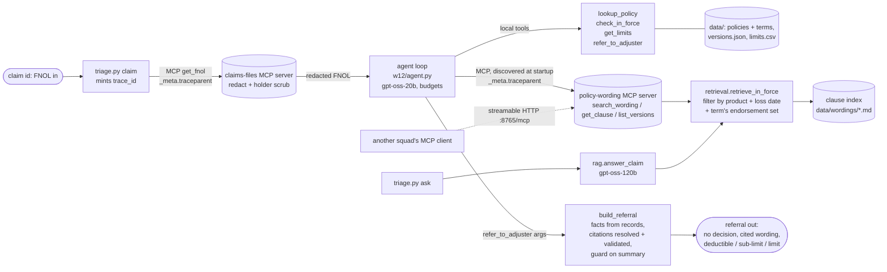

# Architecture: claims triage, Week 12 (one page)

## The path of one claim
1. **FNOL in.** `triage.py claim CLM-…` mints one `trace_id`. The FNOL comes through the **claims-files MCP server**, which redacts it before anything else sees it. Redaction covers names, addresses, phones, emails and injuries (`redact.redact_many`), plus a scrub of the policyholder's record. The request carries `_meta.traceparent`.
2. **Agent loop** (`w12/agent.py`, Week 7 shape). It checks budgets before every model call and paces against the 8k TPM limit outside its latency.
   - **Local tools:** `lookup_policy`, `check_in_force`, `get_limits`, `refer_to_adjuster`.
   - **MCP tools:** whatever the servers in `w12/mcp_config.json` list at startup, i.e. `search_wording`, `get_clause` and `list_versions` from our server, and `get_fnol` / `get_adjuster_notes`. No MCP tool name appears in the agent code.
3. **Wording in force.** `retrieval.retrieve_in_force` drops every chunk from documents not in force *before* the top-k cut, and never backfills.
   - **Which documents count:** the base wording plus the endorsement set **on the policy term covering the loss date**.
   - **Why the term and not the calendar:** a term that started in Jan 2025 keeps the 2023 set for a June 2025 loss.
   - **Refusal:** `get_clause` refuses a clause from wording not in force (HFL-25 on a 2024 loss).
4. **Referral out.** `build_referral` assembles what the adjuster gets.
   - **From records, not the model:** in-force status, term, endorsement set, and limits (deductible, sub-limit and policy limit as three fields). Citations are resolved against the clause registry; each names the clause, endorsement version and the loss date it was resolved for, and links to the clause anchor.
   - **From the model:** clause choice, coverage line, summary.
   - **Guard:** the summary passes through `w12/guard.py`. Any decision language withholds it.
   - **No decision field:** there is no coverage-decision field. A run that ends without a referral, or hits a budget, is referred anyway, with a flag.

## Observability
- **Spans:** every model call, tool call, MCP client call and MCP server call is a span (`w12/trace.py`) with span_id, parent_id, latency, tokens and `cost_usd` at the right model's price.
- **Files:** client spans go to `w12_spans.jsonl`, server spans to `w12_mcp.jsonl` (separate process, same trace id), run summaries to `w12_runs.jsonl`, and referrals to `referrals/`. `python triage.py trace <id>` joins them into one tree.
- **PII lock:** every line is written through a second PII lock that scrubs and re-checks, and refuses the write if a known value survives. `python triage.py check` runs the full PII audit: the generator's ground truth checked against every trace file and against all 1,000 claims-server responses.

## What runs where
| role | model | why |
|---|---|---|
| agent | `openai/gpt-oss-20b` | Week 7's pinned agent model; separate daily quota |
| `ask` (RAG) | `openai/gpt-oss-120b` | Week 3–11's served answer model |
| judge | `openai/gpt-oss-120b`, temp 0 | not the agent's model, not its quota |
| embeddings | local `BAAI/bge-base-en-v1.5` | $0; clause index cached in `.index_cache/` |

## Deliberately not reused
- **`claims_tools.check_policy_exclusions` (Week 7):** it decided coverage from a hard-coded table and treated unknown combinations as "not excluded".
- **The Week 10 orchestrator:** it invented a "denied" when a worker failed.
- **`retrieval._rank_scoped` (Week 11):** its backfill is unsafe here.
